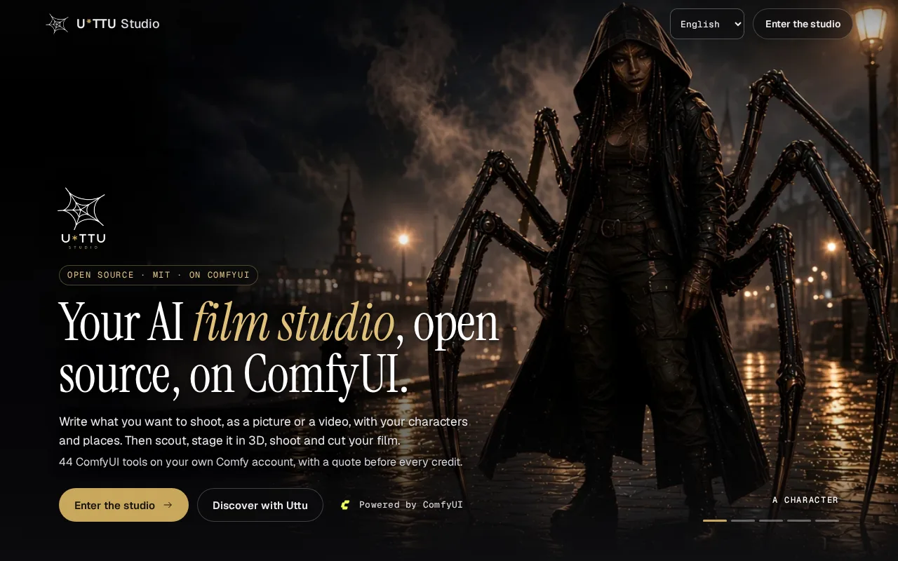
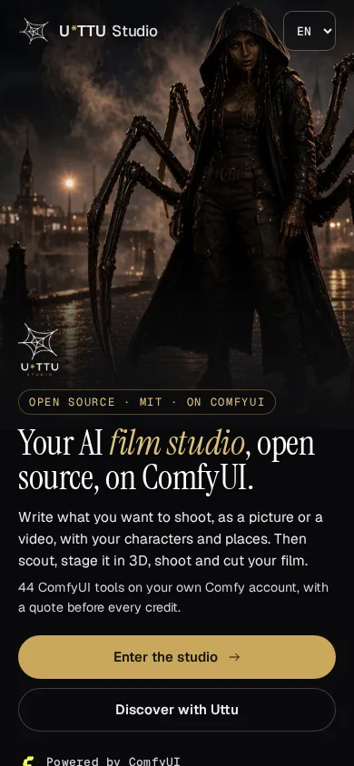
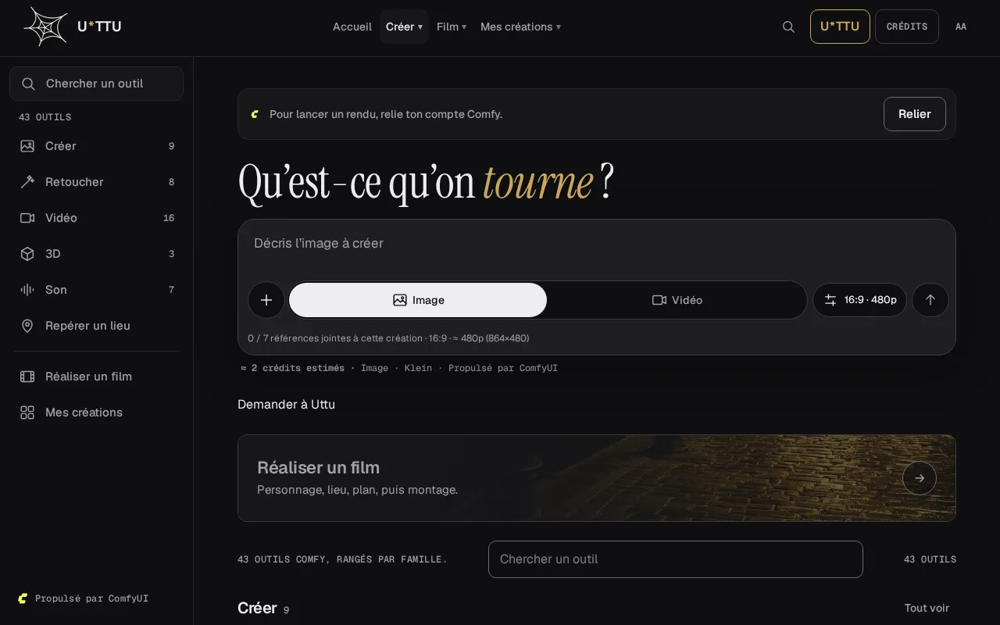
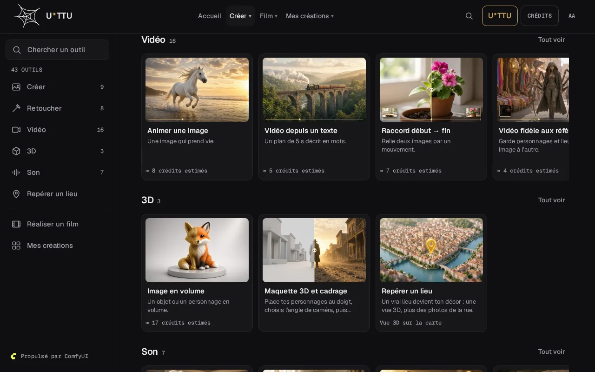
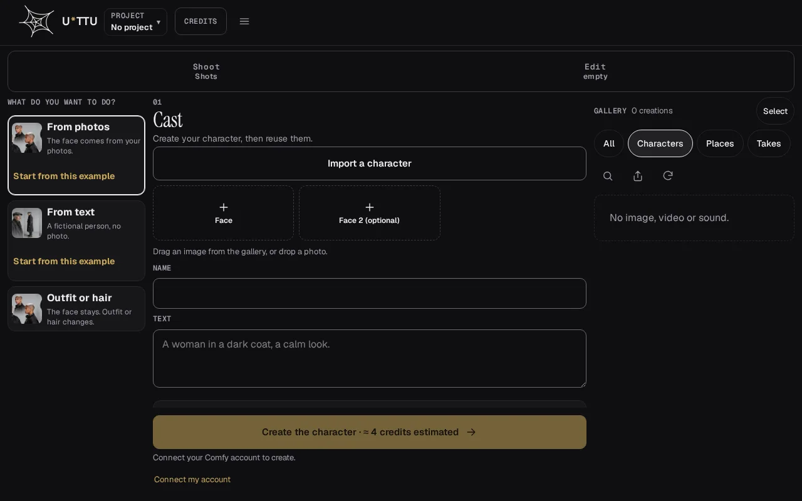
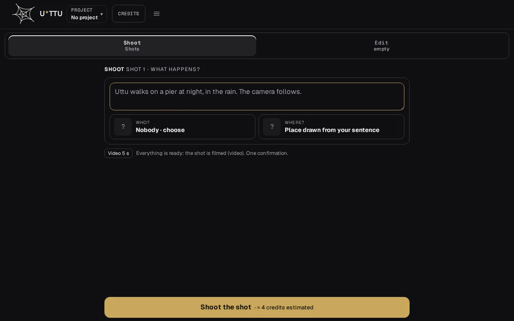
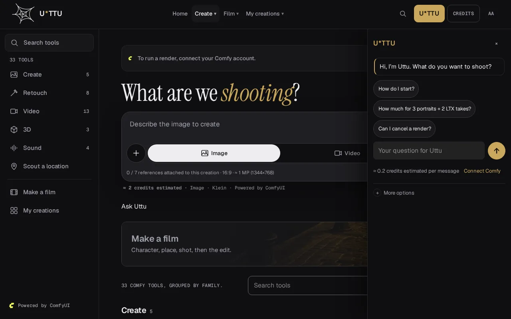
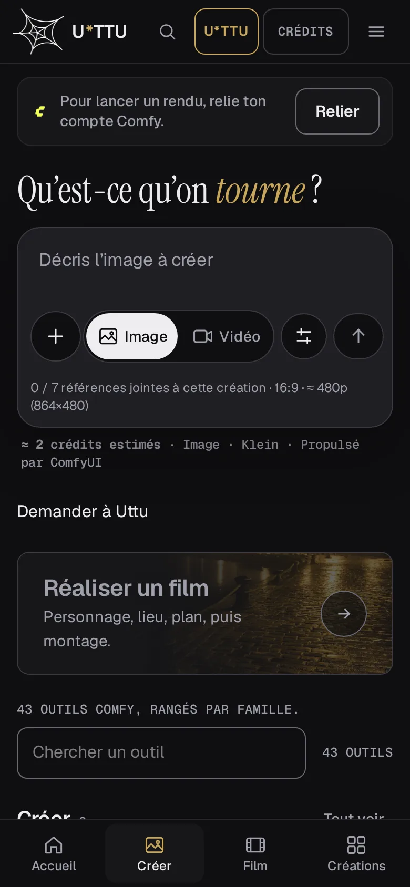
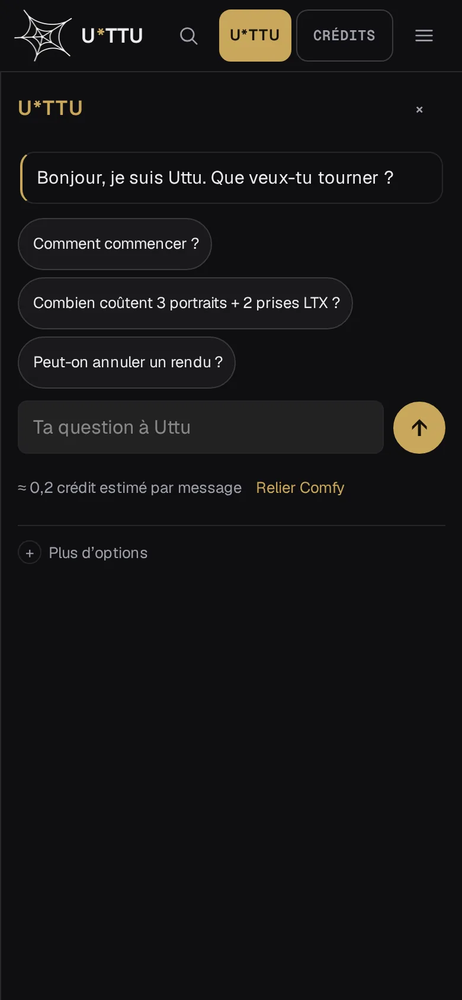
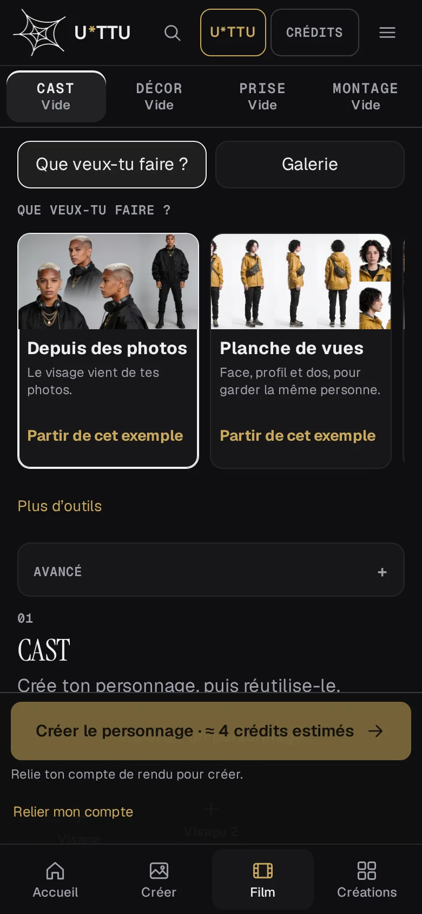

# U*TTU Studio

**EN** — Open-source AI film studio on ComfyUI. Write what you want to shoot, as a picture or a video, keep your characters and places with named references, then stage, shoot and cut a film. Every render runs on your own Comfy account, with a quote before every credit.

**FR** — Studio de cinéma IA open source sur ComfyUI. Écris ce que tu veux tourner, en image ou en vidéo, garde tes personnages et tes lieux avec des références nommées, puis mets en scène, tourne et monte un film. Chaque rendu passe par ton propre compte Comfy, avec un devis avant chaque crédit.

Live: <https://uttu-studio.app> (landing) · studio: <https://uttu-studio.app/studio>, which opens on <https://u-ttu-studio.vercel.app/studio> because Comfy login is only authorized there for now (see [DECISIONS](docs/DECISIONS.md)) · License: [MIT](LICENSE) · Languages: EN (default), FR, DE, ES. The studio opens in English for every new visitor; a language picked in the top bar is kept.

<p>


</p>
<p>


</p>
<p>


</p>
<p>




</p>

<sub>Local build of this branch, 30.10.2026, no account linked (no render of yours is shown). / Build local de cette branche, 30.10.2026, sans compte relié.</sub>

## Principles / Principes

| EN | FR |
|---|---|
| **A quote before every credit.** Every paid button shows « ≈ X credits estimated » (or « measured » once a real job was billed) and waits for your confirmation. The studio never cancels a running Comfy job. | **Un devis avant chaque crédit.** Chaque bouton payant affiche « ≈ X crédits estimés » (ou « mesurés » quand un vrai job a été facturé) et attend ta confirmation. Le studio n’annule jamais un job Comfy lancé. |
| **Your Comfy account.** No server-side key, no account of its own; the studio sells nothing. | **Ton compte Comfy.** Aucune clé côté serveur, aucun compte à lui ; le studio ne vend rien. |
| **One gesture = one exported Comfy workflow** in [`workflows/`](workflows). | **Un geste = un workflow Comfy exporté** dans [`workflows/`](workflows). |
| **Finish enhances, never regenerates.** Upscale and clean what exists; sound and timing stay. | **Finaliser améliore, ne régénère jamais.** Agrandit et rend net ce qui existe ; le son et la cadence restent. |
| **Open weights possible.** « Studio models only » hides partner tools; `scripts/run-local.mjs` sends the same graphs to your own ComfyUI. | **Open weights possible.** « Modèles du studio seulement » cache les outils partenaires ; `scripts/run-local.mjs` envoie les mêmes graphes à ton ComfyUI. |

## What is in the studio / Ce qu’il y a dans le studio

Quotes below are the registry quotes at their default size ([`src/lib/workflows/registre.ts`](src/lib/workflows/registre.ts)); the app shows the exact one before you confirm. / *Les devis ci-dessous sont ceux du registre à la taille par défaut ; l’app affiche le devis exact avant confirmation.*

- **The bubble / La bulle « What are we shooting? · Qu’est-ce qu’on tourne ? »** — Image (Flux Klein, or Qwen edit with references) ≈ 2 credits estimated; Video: MiniMax H3 with references or a sound ≈ 4, LTX-2.5 from text only ≈ 5 (480p, 5 s). Up to 7 references. / *Image (Flux Klein, ou Qwen edit avec références) ≈ 2 crédits estimés ; Vidéo : MiniMax H3 avec références ou un son ≈ 4, LTX-2.5 avec un texte seul ≈ 5.*
- **Named references / Références nommées** — a name and up to 3 photos, filed as Character, Set, Object or Style. / *Un nom et jusqu’à 3 photos, rangés en Personnage, Décor, Objet ou Style.*
- **44 tools / 44 outils** in five families (Create 9, Retouch 8, Video 17, 3D 3, Sound 7), each with its quote. The ten added on 29.10.2026 (measured): / *Dix outils ajoutés le 29.10.2026 (mesurés) :*

  | Tool / Outil | Template | Quote / Devis |
  |---|---|---|
  | Eight character angles / Huit angles du personnage | `templates-1_click_multiple_character_angles-v1.0` | ≈ 11–17 |
  | Eight set angles / Huit angles du décor | `templates-1_click_multiple_scene_angles-v1.0` | ≈ 9–14 |
  | Move the camera / Déplacer la caméra | `template_qwen_multiangle.app` | ≈ 3–5 |
  | Light from your prompt / Lumière par consigne | `image_qwen_image_edit_2509_relight` | ≈ 4–6 |
  | Copy the light of a picture / Copier la lumière d’une image | `templates-portrait_light_migration` | ≈ 3–6 |
  | Faithful keyframes / Images clés fidèles (H3) | `video_minimax_h3_multiframe_reference` | ≈ 14–21 |
  | Style transition / Transition de style (LTX-2.3) | `template_ltx2_3_style_transition` | ≈ 7–11 |
  | Reference-true video, 2nd model / Vidéo fidèle aux références, 2e modèle (FastH3 OmniRef) | `video_fasth3_ominiref_r2v` | ≈ 8–12 |
  | Sound effects for a video / Bruitage d’une vidéo | `api_mirelo_video_to_sfx` (partner) | ≈ 15–18 per 5 s |
  | Split voice and music / Séparer voix et musique | `audio_melbandroformer_audio_separation` | ≈ 1 |

  Multi-camera is a recipe, not a card: eight character angles (once), then one MiniMax H3 take on the angle you pick: ≈ 14 credits for a first shot, then ≈ 4 per extra angle. / *Le multi-caméra est une recette : huit angles (une fois), puis une prise MiniMax H3 sur l’angle choisi : ≈ 14 crédits pour un premier plan, puis ≈ 4 par angle de plus.*
- **Make a film / Réaliser un film: CAST · SET/DÉCOR · SHOOT/PRISE · EDIT/MONTAGE · FINISH/FINALISER.** SHOOT has 5 steps: Prepare, Shots, Preview, Generate, Review. Default engine LTX-2.5 (≈ 18–27 credits for 5 s, measured), MiniMax H3 as second engine (≈ 4–6). In the 3D mock-up you place people and the camera with a finger; « Directed camera » re-shoots that previs with LTX-2.3 IC-LoRA (≈ 15–30, estimated). EDIT: timeline, voice, music, local MP4 export with no credits. / *PRISE en 5 étapes : Préparer, Plans, Prévisualiser, Générer, Réviser. Moteur par défaut LTX-2.5 (≈ 18–27 crédits pour 5 s, mesuré), MiniMax H3 en second moteur (≈ 4–6). Dans la maquette 3D, tu places personnages et caméra au doigt ; « Caméra maîtrisée » retourne cette prévis avec LTX-2.3 IC-LoRA (≈ 15–30, estimé). MONTAGE : timeline, voix, musique, export MP4 local sans crédit.*
- **Finish / Finaliser** — image or take: SeedVR2 (≈ 2 / ≈ 28 for 5 s → 1080p); the whole edit: NVIDIA RTX Video Super Resolution (`utility_nvidia_rtx_video_enhance`, ≈ 4.1 for 5 s, measured 14.10.2026). Never regenerates. / *Image ou prise : SeedVR2 ; tout le montage : RTX Video Super Resolution. Ne régénère jamais.*
- **Your files / Tes fichiers** — photos, MP4/MOV/WebM videos and sounds. With a linked Comfy account they go in original quality (up to 200 MB) through private storage to your Comfy account, then are deleted from that storage. / *Avec ton compte Comfy relié, en qualité originale (jusqu’à 200 Mo) via un stockage privé, effacés dès qu’ils sont chez Comfy.*
- **Scouting / Repérage** — a real place becomes your set: 3D view of the block (OpenStreetMap) and street photos (Panoramax, Wikimedia Commons, KartaView, Mapillary), each with author and licence. / *Un vrai lieu devient ton décor : vue 3D du quartier et photos de rue, chacune avec auteur et licence.*
- **My creations / Mes créations** — projects stay on the device; ZIP export and import; on a computer with Chrome or Edge, « Connect my Obsidian folder ». / *Les projets restent sur l’appareil ; export et import ZIP ; sur ordinateur, « Relier mon dossier Obsidian ».*

## Uttu, the studio agent / Uttu, l’agent du studio

**EN** — « Ask Uttu » opens the panel. Without an account it offers the cost simulator (« 3 portraits + 2 LTX takes ») and an invite to link Comfy. With your Comfy account linked, Uttu answers in its own words through Comfy Router: ≈ 0.2 credits estimated per message at most, shown and accepted before the first message, paid by your account. It suggests a tool or a plan; it launches nothing. Its knowledge (`public/agent/knowledge.json`) is generated at build time by [`scripts/agent-knowledge.mjs`](scripts/agent-knowledge.mjs) from the tool catalogue, the registry and the four message files; [`tests/uttu-studio-sync.test.ts`](tests/uttu-studio-sync.test.ts) fails if an open tool is missing or a closed one is named.

**FR** — « Demander à Uttu » ouvre le panneau. Sans compte : le simulateur de coûts (« 3 portraits + 2 prises LTX ») et une invitation à relier Comfy. Avec ton compte Comfy relié, Uttu répond avec ses mots via Comfy Router : ≈ 0,2 crédit estimé par message au plus, affiché et accepté avant le premier message, payé par ton compte. Il propose un outil ou un plan ; il ne lance rien. Sa connaissance est générée au build à partir du catalogue, du registre et des quatre fichiers de messages ; un test échoue si un outil ouvert manque ou si un outil fermé est nommé.

## For the jury / Pour le jury

| EN | FR |
|---|---|
| 1. Open <https://uttu-studio.app>. The page follows your browser language; the language menu keeps your choice. | 1. Ouvre <https://uttu-studio.app>. La page suit la langue du navigateur ; le menu de langue garde ton choix. |
| 2. **Discover with Uttu** or **Enter the studio**. Without an account: cost simulator, getting-started guide, scouting, 3D mock-up, EDIT timeline, project export. | 2. **Découvrir avec Uttu** ou **Entrer dans le studio**. Sans compte : simulateur de coûts, guide, repérage, maquette 3D, timeline de MONTAGE, export du projet. |
| 3. To render: **Credits → Connect the render account → Sign in with Comfy**, or paste a Comfy Cloud API key (paid Comfy Cloud plan). Session and key stay in your browser. | 3. Pour rendre : **Crédits → Relier le compte de rendu → Se connecter avec Comfy**, ou colle une clé API Comfy Cloud (abonnement payant). Session et clé restent dans ton navigateur. |
| 4. A 5-render path: CAST from text ≈ 4 · SET from text ≈ 4 · SHOOT LTX 5 s ≈ 18 · EDIT 0 · Finish the edit ≈ 4.1 (all measured). | 4. Parcours en 5 rendus : CAST depuis un texte ≈ 4 · DÉCOR ≈ 4 · PRISE LTX 5 s ≈ 18 · MONTAGE 0 · Finaliser le montage ≈ 4,1 (tous mesurés). |
| 5. Without Comfy Cloud: « Run locally » below. | 5. Sans Comfy Cloud : « Lancer en local » plus bas. |

## Measured / Mesuré

The registry lists **102 gestures: 79 open, 48 with a real billed run** (« measured »), the other open ones « estimated »; 23 stay closed. Nine of the closed rows are the Anime 2.5D look: hidden until a project chooses it, and unmeasured costs stay estimates. Billing was read job by job: [docs/mesures/test-visiteur-2026-10-27.md](docs/mesures/test-visiteur-2026-10-27.md), [docs/mesures/workflows-top10-2026-10-29.md](docs/mesures/workflows-top10-2026-10-29.md). / *Le registre compte **102 gestes : 79 ouverts, dont 48 avec un vrai rendu facturé** (« mesuré »), les autres « estimés » ; 23 restent fermés. Neuf d'entre eux sont le look Anime 2.5D, cachés tant qu'un projet ne le choisit pas.*

| Area / Domaine | Measured quote, credits / Devis mesuré, crédits |
|---|---|
| CAST · SET / DÉCOR | from text / depuis un texte ≈ 4 · from photos / depuis des photos ≈ 4 (CAST) · ≈ 6 (DÉCOR) · time of day / heure ≈ 6 |
| SHOOT / PRISE | LTX-2.5 5 s ≈ 18 · MiniMax H3 ≈ 4 · bridge / raccord ≈ 7 · widen / élargir ≈ 16 · remove an object / effacer ≈ 25 · 3D object / objet 3D ≈ 17 |
| After a take / Après une prise | edit / modifier ≈ 5 · finalise image ≈ 2 · cut out / détourer ≈ 1 · widen image ≈ 5 · finalise video 5 s ≈ 28 · smooth / fluidifier ≈ 2 · continue / prolonger ≈ 6 · make it talk / faire parler ≈ 8 |
| Image tools / Outils image | Klein ≈ 3 · Qwen ≈ 3 · references / références ≈ 2 · GPT Image ≈ 1 · Seedream ≈ 10 · FLUX 3 ≈ 14 · Ideogram ≈ 18 · sketch / croquis ≈ 17 · 360° ≈ 20 |
| Video tools / Outils vidéo | text to video / texte → vidéo ≈ 5 · Wan ≈ 8 · motion / mouvement ≈ 17 · cut out / détourer ≈ 63 · Vidu ≈ 100 · lip sync / lèvres ≈ 280 |
| Sound tools / Outils son | open voice / voix ouverte (Chatterbox) ≈ 3 · dialogue ≈ 4 · open music / musique ouverte (ACE-Step) ≈ 3 · open sound effect / bruitage ouvert (Stable Audio) ≈ 2 |

Example media in `public/exemples/` say how they were made (`public/exemples/A-GENERER.json`). `public/exemples/outils/plan-exemple.mp4` is a sample clip to try the video tools, not a model render. / *Les exemples disent comment ils ont été faits ; `plan-exemple.mp4` est un clip d’essai, pas un rendu.*

## Engines / Moteurs

Renders go through the documented **Comfy Cloud API** (`/api/upload/image`, `/api/prompt`, `/api/job/{id}/status`, `/api/jobs/{id}`, `/api/view`, balance from `api.comfy.org`) via a same-origin relay that stores nothing ([`src/lib/comfy-proxy.ts`](src/lib/comfy-proxy.ts)).

| Tab / Onglet | Default / Par défaut | Template(s) | Weights |
|---|---|---|---|
| CAST · SET | FLUX 3 Image Klein (text, photo edit, time of day) | `image_flux3_klein_t2i`, `image_flux3_klein_image_edit` | open |
| CAST | FLUX 3 Image (several references, view sheet) | `api_bfl_flux3_image_edit` | partner |
| SHOOT | LTX-2.5 i2v, first frame composed by Klein from character + set | `video_ltx2_5_i2v` | open |
| SHOOT | MiniMax H3 reference-to-video (second engine) | `video_minimax_h3_r2v` | open |
| SHOOT (VFX) | Directed camera (MoGe depth + LTX-2.3 IC-LoRA), bridge, camera, widen, remove an object | `video_ltx2_5_flf2v`, `video_ltx2_3_ic_lora`, `template_ltx2_3_lora_video_outpainting`, `template_ltx2_3_obscura_remova_lora_remove_object_from_video` | open |
| MONTAGE | voice, music, sound effect: ElevenLabs, Sonilo; open tools: Chatterbox, ACE-Step, Stable Audio | `api_elevenlabs_*`, `api_sonilo_t2m`, `audio-chatterbox_tts_multilingual`, `audio_ace_step1_5_xl_turbo`, `audio_stable_audio_3_medium` | partner / open |
| Finaliser | SeedVR2 (image, take); RTX Video Super Resolution (whole edit) | `utility_seedvr2_3b_int8_upscale_*`, `utility_nvidia_rtx_video_enhance` | open / NVIDIA licence |

« Versatile model (optional) » (Nano Banana) is off by default. « Studio models only » hides partner tools and rejects them again before sending; RTX finalisation stays closed in that mode until its licence is verified. / *« Modèle polyvalent (option) » est éteint par défaut. « Modèles du studio seulement » cache les outils partenaires et les refuse avant envoi ; la finalisation RTX reste fermée dans ce mode.*

## Workflows

- `workflows/<tab>/<gesture>.json` — the official Comfy template (drag it into ComfyUI) / *le template officiel* ;
- `workflows/<tab>/<gesture>.api.json` — the exact API graph the studio sends / *le graphe exact envoyé* ;
- `workflows/index.json` — gesture → template, partner nodes; kept equal to the registry by `tests/workflows-export.test.ts`.

Regenerate / Régénérer : `node --experimental-strip-types scripts/export-workflows.mjs`. Details: [docs/WORKFLOWS.md](docs/WORKFLOWS.md), [docs/AUDIT-WORKFLOWS-COMFY.md](docs/AUDIT-WORKFLOWS-COMFY.md).

## Run locally / Lancer en local

Node ≥ 22.

```bash
npm ci
npm run dev          # http://localhost:3000 (landing) · /studio
npm test             # unit tests / tests unitaires
npm run typecheck
npm run build        # writes public/agent/knowledge.json, then next build
npm run test:e2e     # Playwright
```

With your own ComfyUI (open weights, no Comfy Cloud credits) / *Avec ton propre ComfyUI :*

```bash
node scripts/run-local.mjs workflows/prise/prise-plan.api.json \
  --text "Uttu walks along the quay at night" \
  --image uttu-personnage.jpg=./uttu.png --image uttu-lieu.jpg=./quay.png
```

The script refuses graphs with partner nodes unless `--allow-partner` is set. / *Le script refuse les graphes avec nœuds partenaires sans `--allow-partner`.*

## Storage and export / Stockage et export

Projects are stored in the browser (request storage protection and download a ZIP backup from My creations; clearing browser data removes them). Local MP4 export: H.264/AAC, up to 60 s, 960×540 or 540×960 at 12 fps. / *Les projets restent dans le navigateur (protection et copie ZIP depuis Mes créations). Export MP4 local : H.264/AAC, 60 s au plus, 960×540 ou 540×960 à 12 i/s.*

The contest branch is not a production validation: see [docs/audit-2026-10-14/integration-concours.md](docs/audit-2026-10-14/integration-concours.md). Next step, not built: cloud Blender over MCP ([docs/BLENDER-MCP.md](docs/BLENDER-MCP.md)).

## Credits

Street-level references: [Panoramax](https://panoramax.fr) (CC BY-SA), OpenStreetMap/Photon; Google imagery is never sent to a model. Example character: Uttu (original design by the author). See [docs/CREDITS.md](docs/CREDITS.md).
