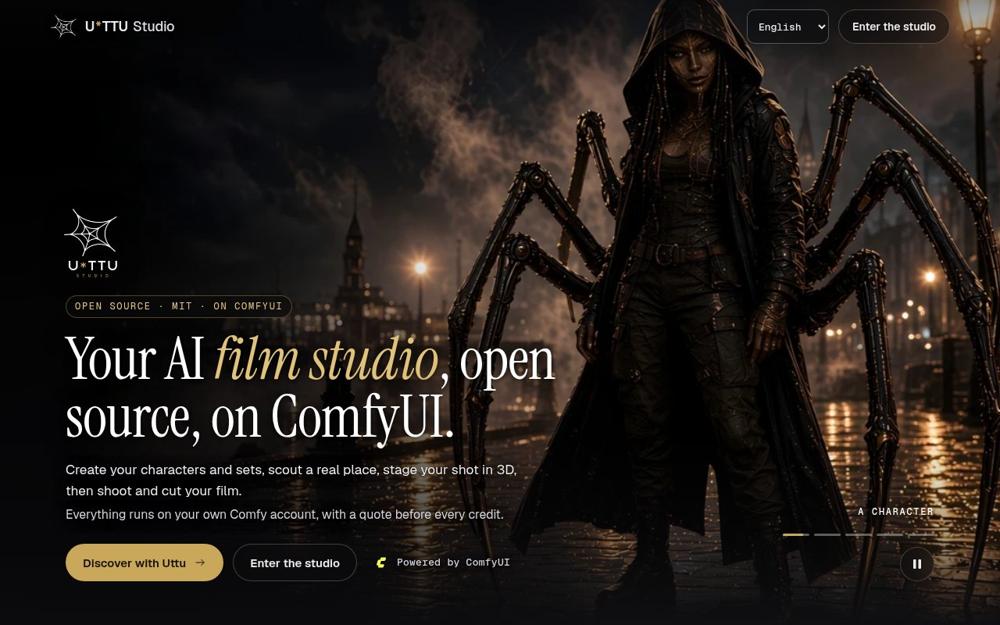
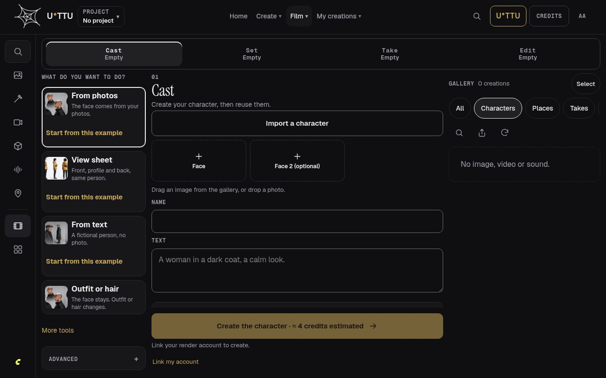
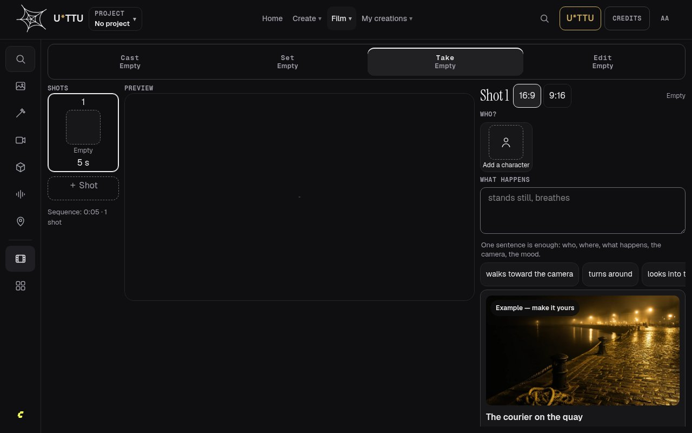
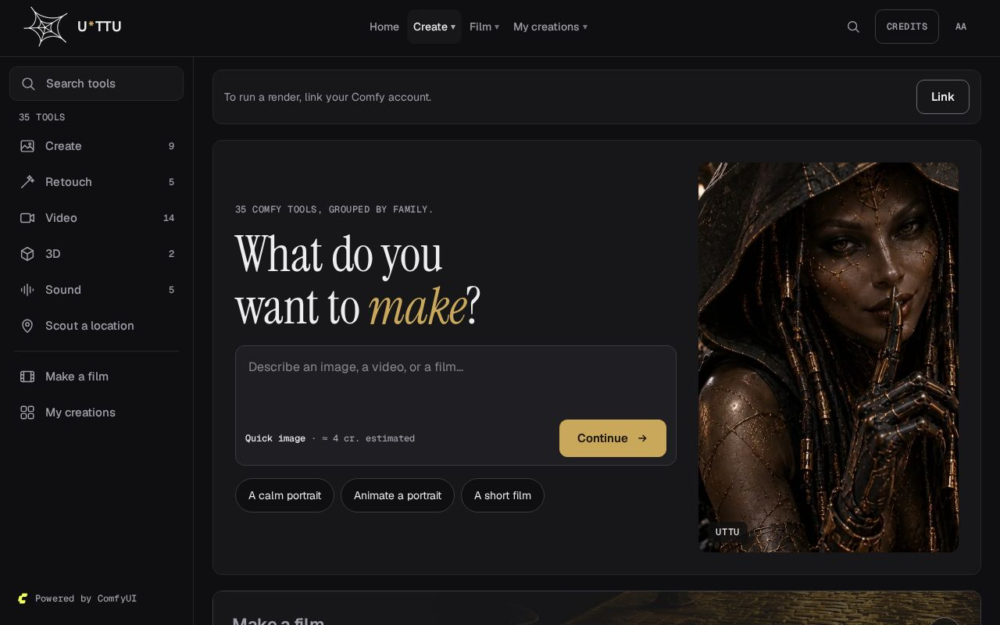
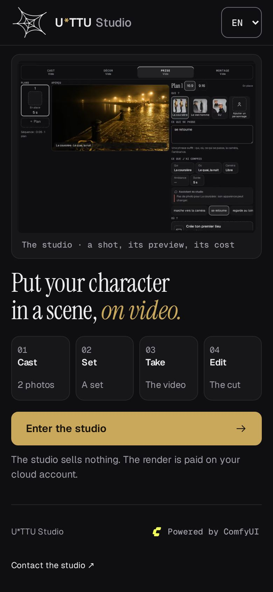
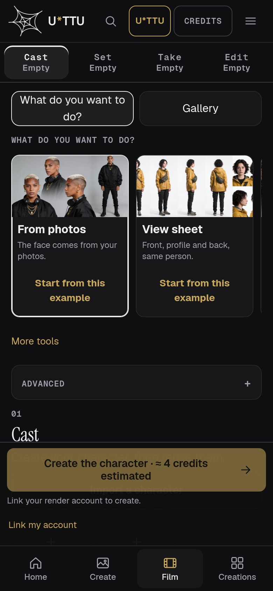
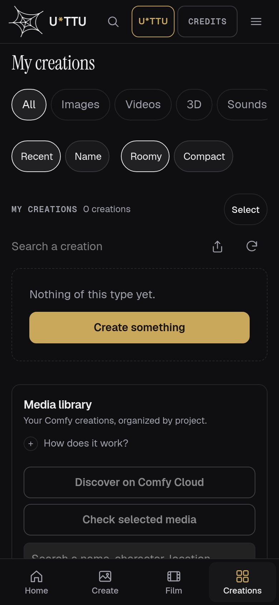

# U*TTU Studio

**Open-source AI film studio on ComfyUI: direct your shot in 3D on your phone, LTX films it.**

Block your actors and the camera path with a finger in a 3D mock-up (previs). The studio records that mock-up in the browser, and LTX-2.3 IC-LoRA re-shoots it on your character and set with the same camera move. Character, set, take and edit live in four tabs (CAST · SET · TAKE · EDIT); every render runs on your own Comfy Cloud account, with a quote before any credit is spent.

**FR** — *Studio de cinéma IA open source sur ComfyUI : mets en scène ton plan en 3D sur ton téléphone, LTX le tourne.* Tu places tes personnages et le trajet de la caméra au doigt dans une maquette 3D ; le studio la filme dans le navigateur, et LTX-2.3 IC-LoRA retourne le plan avec ton personnage et ton décor, au même mouvement de caméra. Chaque rendu passe par ton compte Comfy Cloud, avec un devis avant chaque crédit.

Live: <https://u-ttu-studio.vercel.app/studio> · License: [MIT](LICENSE) · Languages: FR (source), EN, DE, ES.

<p>


</p>
<p>


</p>
<p>



</p>

<sub>Real screenshots of the studio (production build, English, 1280 px and 390 px, 22 October 2026). No account linked, so no render is shown.</sub>

## Higgsfield Cinema Studio → U*TTU → Comfy

What a Cinema Studio feature becomes here: one gesture in the studio, one exported Comfy workflow in [`workflows/`](workflows) (official template + the exact API graph the studio sends). Only wired gestures are listed.

| Higgsfield Cinema Studio | U*TTU gesture (tab) | Comfy workflow (template) |
|---|---|---|
| Director Mode camera moves | **Directed camera** (TAKE): your finger sets actors and camera path in the 3D mock-up, the recorded previs drives the shot | [`prise/prise-previs`](workflows/prise/prise-previs.api.json), [`prise/prise-camera`](workflows/prise/prise-camera.api.json) (`video_ltx2_3_ic_lora`) |
| Hero Frame First (still, then animate) | **Person in the set** (TAKE): FLUX 3 Klein composes the first frame from your character and set, LTX-2.5 animates it, in one graph | [`prise/prise-plan`](workflows/prise/prise-plan.api.json) (`video_ltx2_5_i2v`) |
| Soul Cast characters / Elements | **From photos**, **From text**, **View sheet** (CAST) | [`cast/cast-photos`](workflows/cast/cast-photos.api.json) (`image_flux3_klein_image_edit`), [`cast/cast-texte`](workflows/cast/cast-texte.api.json) (`image_flux3_klein_t2i`), [`cast/cast-planche`](workflows/cast/cast-planche.api.json) (`api_bfl_flux3_image_edit`, partner) |
| Locations (Elements) | **From text**, **From a photo** of a real place, **time of day** (SET) | [`decor/decor-texte`](workflows/decor/decor-texte.api.json), [`decor/decor-photo`](workflows/decor/decor-photo.api.json), [`decor/decor-heure`](workflows/decor/decor-heure.api.json) (FLUX 3 Klein) |
| Start and end keyframes | **Bridge** (TAKE): the first picture meets the last | [`prise/prise-raccord`](workflows/prise/prise-raccord.api.json) (`video_ltx2_5_flf2v`) |
| Edit Video (regional edits) | **Remove an object**, **Widen the shot** (TAKE) | [`prise/prise-effacer`](workflows/prise/prise-effacer.api.json), [`prise/prise-elargir`](workflows/prise/prise-elargir.api.json) (LTX-2.3 LoRA templates) |
| Forward extend | **Continue** (after a take): 5 more seconds from the last frame | [`suite/suite-prolonger`](workflows/suite/suite-prolonger.api.json) (`video_minimax_h3_i2v_continuation`) |
| Talking characters | **Make it talk** (after a take), **Voice** (EDIT) | [`suite/suite-parler`](workflows/suite/suite-parler.api.json) (`video_ltx2_3_ia2v`), [`montage/mont-voix`](workflows/montage/mont-voix.api.json) (ElevenLabs, partner) |
| Up to 1080p output | **Finalize** (EDIT) and **Enhance video**: upscale and restore, never regenerate | [`finaliser/montage-finaliser`](workflows/finaliser/montage-finaliser.api.json) (`utility_nvidia_rtx_video_enhance`), [`suite/suite-finaliser-video`](workflows/suite/suite-finaliser-video.api.json) (`utility_seedvr2_3b_int8_upscale_video`) |
| AI director chat | **U\*TTU** (top bar): free local guide, FAQ and cost simulator; optional Comfy agent paid by your Comfy account | Not a workflow: Comfy Router (`gpt-5-nano`), [`src/app/studio-agent`](src/app/studio-agent) |

Not reproduced: Cinema Studio's genre, era, lens, colour-grade and lighting presets, and 30-second clips.

## For the jury / Pour le jury

**EN**

1. Open <https://u-ttu-studio.vercel.app> on a computer or a phone. The page follows your browser language (FR, EN, DE or ES, English otherwise); the language menu switches it and keeps your choice.
2. **Try free (0 credits)** opens the studio with **U\*TTU**, the free guide: getting started, FAQ and a cost simulator, all local, no account. Everything else that costs nothing works too: « Start from this example » in each tab, a 3D previs in TAKE, the timeline in EDIT, project export.
3. **To render, link your own Comfy account:** **Credits → Connect the render account → Sign in with Comfy**, or **I have a key** and paste a Comfy Cloud API key ([platform.comfy.org/profile/api-keys](https://platform.comfy.org/profile/api-keys); a paid Comfy Cloud plan is needed). Session and key stay in your browser; the studio has no server-side key and no account of its own.
4. Every paid button shows its quote first (« ≈ X cr. estimated », or measured once measured) and asks for a confirmation; the balance must cover the reserve. Suggested 5-run path: CAST « From text » (≈ 4 cr.), SET « From text » (≈ 4 cr.), TAKE with the default LTX engine (≈ 12–25 cr. estimated), then EDIT and Finalize.
5. The studio never cancels a Comfy job. If you stop waiting, the job keeps running on your account and lands in My creations.
6. Optional **Comfy agent**: once linked, switch U\*TTU to « Comfy agent ». It answers in its own words through Comfy Router (≈ 0.2 cr. estimated per message at most, paid by your Comfy account) and launches nothing: it suggests, you click.
7. Without Comfy Cloud: « Run locally » below (`scripts/run-local.mjs` with your own ComfyUI, open weights).

**FR**

1. Ouvre <https://u-ttu-studio.vercel.app> sur ordinateur ou téléphone. La page suit la langue de ton navigateur (FR, EN, DE ou ES, sinon l’anglais) ; le menu de langue la change et garde ton choix.
2. **Essayer gratuitement (0 crédit)** ouvre le studio avec **U\*TTU**, le guide gratuit : premiers pas, FAQ et simulateur de coûts, tout en local, sans compte. Tout ce qui ne coûte rien marche aussi : « Partir de cet exemple » dans chaque onglet, une prévis 3D dans PRISE, la timeline de MONTAGE, l’export du projet.
3. **Pour rendre, relie ton propre compte Comfy :** **Crédits → Relier le compte de rendu → Se connecter avec Comfy**, ou **J’ai une clé** et colle une clé API Comfy Cloud ([platform.comfy.org/profile/api-keys](https://platform.comfy.org/profile/api-keys) ; un abonnement Comfy Cloud payant est nécessaire). Session et clé restent dans ton navigateur ; le studio n’a ni clé côté serveur ni compte à lui.
4. Chaque bouton payant montre d’abord son devis (« ≈ X cr. estimés », ou mesuré quand il l’a été) et demande une confirmation ; le solde doit couvrir la réserve. Parcours conseillé en 5 rendus : CAST « Depuis un texte » (≈ 4 cr.), DÉCOR « Depuis un texte » (≈ 4 cr.), PRISE avec le moteur LTX par défaut (≈ 12–25 cr. estimés), puis MONTAGE et Finaliser.
5. Le studio n’annule jamais un job chez Comfy. Si tu arrêtes d’attendre, le rendu continue sur ton compte et arrive dans Mes créations.
6. **Agent Comfy** en option : une fois relié, passe U\*TTU en « Agent Comfy ». Il répond avec ses mots via Comfy Router (≈ 0,2 cr. estimés par message au plus, payés par ton compte Comfy) et ne lance rien : il propose, tu cliques.
7. Sans Comfy Cloud : « Lancer en local » plus bas (`scripts/run-local.mjs` avec ton propre ComfyUI, open weights).

## What is measured, and what is not / Ce qui est mesuré, et ce qui ne l’est pas

**EN** — The registry lists 79 gestures. **4 have a real measured run**: CAST and SET from a text (`image_flux3_klein_t2i`, about 4 credits), SET from a photo (`image_flux3_klein_image_edit`, about 4), and the MiniMax H3 take (`video_minimax_h3_r2v`, 4.3). Every other gesture is wired and tested against a simulated Comfy, and its quote is labelled « estimated ». **LTX is the default video engine in the code, but no LTX take has been rendered yet**: the first ones wait for credits.

The example images in `public/exemples/` say how they were made:
- The SET stills (quay, rainy street, rooftop, station) were rendered with **FLUX 3 Image Klein** (open weights) via Comfy Cloud.
- Three CAST portraits and two sets were rendered with **Seedream 4.5** (partner) via Comfy Cloud.
- The six « after » examples (`apres-*.webp`) were rendered on 8 October 2026, **before Klein became the default**, with **Nano Banana 2.1** and the `templates-character_sheet` template (Gemini, partner). They are kept as they are, with their measured cost in `public/exemples/A-GENERER.json`, and will be re-rendered with Klein.
- `public/exemples/outils/plan-exemple.mp4` (3 s) is a sample clip to try the video tools, **not** a render from a video model.

**FR** — Le registre compte 79 gestes. **4 ont un vrai rendu mesuré** : CAST et DÉCOR depuis un texte (`image_flux3_klein_t2i`, environ 4 crédits), DÉCOR depuis une photo (`image_flux3_klein_image_edit`, environ 4), et la prise MiniMax H3 (`video_minimax_h3_r2v`, 4,3). Les autres gestes sont branchés et testés contre un Comfy simulé ; leur devis est marqué « estimé ». **LTX est le moteur vidéo par défaut dans le code, mais aucune prise LTX n’a encore été rendue** : les premières attendent des crédits.

Les images d’exemple de `public/exemples/` disent comment elles ont été faites :
- Les décors (quai, rue sous la pluie, toit, gare) sont rendus en **FLUX 3 Image Klein** (open weights) via Comfy Cloud.
- Trois portraits CAST et deux décors sont rendus en **Seedream 4.5** (partenaire) via Comfy Cloud.
- Les six exemples « après » (`apres-*.webp`) datent du 8 octobre 2026, **avant que Klein devienne le défaut** : **Nano Banana 2.1** et le template `templates-character_sheet` (Gemini, partenaire). Ils restent tels quels, avec leur coût mesuré dans `public/exemples/A-GENERER.json`, et seront refaits en Klein.
- `public/exemples/outils/plan-exemple.mp4` (3 s) est un clip pour essayer les outils vidéo, **pas** un rendu d’un modèle vidéo.

---

## English

### Built on the Comfy Developer Platform

Every render runs on the visitor's own Comfy account through the documented **Comfy Cloud API** (`POST /api/upload/image`, `POST /api/prompt`, `GET /api/job/{id}/status`, `GET /api/jobs/{id}`, `GET /api/view`, balance from `api.comfy.org`), via a same-origin relay that stores nothing ([`src/lib/comfy-proxy.ts`](src/lib/comfy-proxy.ts)). The studio sells nothing and keeps no visitor account; files live in a local vault on the device.

| Tab | Default engine | Template(s) | Weights |
| --- | --- | --- | --- |
| CAST | **FLUX 3 Image Klein** (text, photo edit, outfit) | `image_flux3_klein_t2i`, `image_flux3_klein_image_edit` | open |
| CAST | **FLUX 3 Image** (several references, view sheet) | `api_bfl_flux3_image_edit` | partner |
| DÉCOR | **FLUX 3 Image Klein** (text, real place photo, time of day) | `image_flux3_klein_t2i`, `image_flux3_klein_image_edit` | open |
| PRISE | **LTX-2.5** image-to-video, first frame composed by FLUX 3 Klein from character + set (one graph) | `video_ltx2_5_i2v` (+ Klein edit) | open |
| PRISE | **MiniMax H3** reference-to-video, second engine | `video_minimax_h3_r2v` | open |
| PRISE (video gestures) | **Directed camera** (previs-to-picture: the studio's 3D maquette is filmed in the browser, MoGe depth + LTX-2.3 IC-LoRA union control render the shot), LTX-2.5 first/last frame bridge, LTX-2.3 IC-LoRA camera, LTX-2.3 video outpainting and object removal (VFX / re-shoot) | `video_ltx2_5_flf2v`, `video_ltx2_3_ic_lora`, `template_ltx2_3_lora_video_outpainting`, `template_ltx2_3_obscura_remova_lora_remove_object_from_video` | open |
| MONTAGE | voice, sound effect, music | ElevenLabs, Sonilo partner templates | partner |
| Finalize | NVIDIA RTX Video Super Resolution on the whole edit, optional denoise/deblur (never regenerates) | `utility_nvidia_rtx_video_enhance` (Super Resolution stage) | see NVIDIA license; not verified for Open Weights Only |

Nano Banana stays available as an **option, off by default** (toggle « Nano Banana (option) »). **Open weights only** hides partner gestures and rejects them again before submission. RTX finalization is unavailable in that mode until its model license is verified; local MP4 export remains available. Both toggles sit above the gesture cards; the PRISE tab has an engine switch (LTX-2.5 default / MiniMax H3).

### Workflows

[`workflows/`](workflows) holds one Comfy workflow per gesture:

- `workflows/<tab>/<gesture>.json` — the official Comfy template the gesture comes from (UI format: drag it into ComfyUI);
- `workflows/<tab>/<gesture>.api.json` — the exact API graph the studio sends, for wired gestures (placeholders `uttu-*.jpg` and `<texte du visiteur>`);
- `workflows/index.json` — gesture → template, partner nodes, files. `tests/workflows-export.test.ts` keeps it equal to the registry ([`src/lib/workflows/registre.ts`](src/lib/workflows/registre.ts)).

Regenerate: `node --experimental-strip-types scripts/export-workflows.mjs` (reads templates from `Comfy-Org/workflow_templates`, partner flags from a local ComfyUI `/object_info` when one runs).

### Run locally

Requirements: Node ≥ 22.

```bash
npm ci
npm run dev          # http://localhost:3000/studio
npm test             # unit tests
npm run build
```

Link a Comfy Cloud account in the app (session or API key, kept on the device) to render.

**Fully local, open weights, with your own ComfyUI:**

1. Install/update [ComfyUI](https://github.com/comfyanonymous/ComfyUI) and start it (`python main.py`, default `http://127.0.0.1:8188`).
2. Open any `workflows/<tab>/<gesture>.json` in ComfyUI: the template's notes list the model files and their Hugging Face links (FLUX 3 Image Klein, LTX-2.5, MiniMax H3, SeedVR2).
3. Or run the studio's exact graph: 
   ```bash
   node scripts/run-local.mjs workflows/prise/prise-plan.api.json \
     --text "Uttu walks along the quay at night" \
     --image uttu-personnage.jpg=./uttu.png --image uttu-lieu.jpg=./quay.png
   ```
   The script refuses graphs with partner nodes unless `--allow-partner` is set.

Every feature runs through its dedicated Comfy workflow (official template, exported): see `docs/AUDIT-WORKFLOWS-COMFY.md`.

### Touch previs (phone)
In PRISE, the 3D maquette is driven by touch: one finger orbits or moves a person or a prop, two fingers pinch. A camera path is built from timed keyframes (up to 8 over 5 s, eased). « Sentence → scene » is a small rule-based agent (FR/EN/DE/ES, no language model, no network) that lays out mannequins, props and a camera move. Props are primitives or an imported `.glb`, simplified on the device (20 000 triangles on a phone). « Film the previs » records 5 s of the canvas with MediaRecorder and hands the clip straight to « Directed camera » (LTX-2.3 IC-LoRA). « Generate in 3D » runs the official open-weights templates `3d_hunyuan3d-v2.1` (person) and `3d_pixal3d_trellis2_image_to_model` (prop or set, decimated to 40 000 faces by the template's own node), with an estimated quote and a confirmation before any spend.

### Next step: cloud Blender over MCP (not built)
Version 2 keeps the phone as a light three.js editor and lets an agent drive a headless Blender in the cloud for richer scenes and exact depth/pose passes:
- **Where Blender runs:** a GPU container billed per second (e.g. Modal L4), or a managed Blender MCP service such as Sceneplane (to be tested, pricing not checked).
- **How the agent drives it:** strict JSON tools (`add_actor`, `set_camera_path`, `import_glb`, `render_previs`) translated to `bpy`. The `mcp-for-blender` addon executes arbitrary Python over an unauthenticated socket: it only ever runs behind a private network or an SSH tunnel, never exposed publicly.
- **What comes back:** a GLB the phone reopens, and an Eevee/Workbench previs MP4 (depth or pose) sent to the same « Directed camera » workflow.
- **Rules kept:** quote before every spend, the language-model agent's cost is capped and shown, Comfy stays the only renderer of the final shot.
- Research behind this plan: the previs-mobile study of 16.10.2026 (not in the repo).

### Spending rules

A quote is shown before every spend; Create/Shoot stays off when the balance does not cover the required reserve (not a guaranteed billing cap). LTX-2.5 takes and the video gestures have no measured take yet: their quote is labelled « Estimé » / estimated (never shown as measured), the visitor confirms the estimate and its uncertainty, and the balance must cover the reserve. Running jobs are never cancelled by the studio on its own. Finalize only upscales/restores.

### Credits

Street-level references come from [Panoramax](https://panoramax.fr) (CC BY-SA: derived sets inherit share-alike) and OpenStreetMap/Photon. Google imagery is never sent to a model. Example character: Uttu (original design by the author).

---

## Français

### Sur la Comfy Developer Platform

Chaque rendu part sur le compte Comfy du visiteur par l’**API Comfy Cloud** documentée, via un relais même origine qui ne garde rien. Le studio ne vend rien et ne garde aucun compte ; les fichiers restent dans un coffre local.

- **CAST et DÉCOR :** FLUX 3 Image Klein (open weights) par défaut ; FLUX 3 Image (nœud partenaire) pour plusieurs références et la planche ; Nano Banana en option, éteinte par défaut.
- **PRISE :** LTX-2.5 par défaut (FLUX 3 Klein compose la première image à partir du personnage et du décor, puis LTX-2.5 l’anime, dans un seul graphe) ; MiniMax H3 en second moteur. Gestes vidéo : caméra maîtrisée (la maquette 3D filmée dans le navigateur sert de prévis ; profondeur MoGe + IC-LoRA LTX-2.3 rendent le plan), raccord LTX-2.5, caméra LTX-2.3 IC-LoRA, élargir le plan et effacer un objet (VFX, re-shoot).
- **MONTAGE :** voix, effet, musique (partenaires) ; Finaliser : RTX Video Super Resolution (étape du template `utility_nvidia_rtx_video_enhance`), sans jamais refaire le rendu.
- **Open weights seulement :** cache les gestes partenaires et les refuse avant envoi. La finalisation RTX, non vérifiée pour ce mode, reste fermée ; l’export MP4 local reste disponible.

### Workflows

Un fichier par geste dans `workflows/<onglet>/` : le template officiel (`.json`, à ouvrir dans ComfyUI) et, si le geste est branché, le graphe exact envoyé par le studio (`.api.json`). `workflows/index.json` dit lequel passe par un partenaire. Détail des gestes : [docs/WORKFLOWS.md](docs/WORKFLOWS.md).

### Lancer en local

```bash
npm ci && npm run dev   # http://localhost:3000/studio
```

Avec ton propre ComfyUI (open weights, sans crédit) : lance ComfyUI, ouvre un `workflows/…/*.json`, ou envoie le graphe exact du studio avec `node scripts/run-local.mjs <graphe.api.json> --text "…" --image nom=fichier`.

### Prévis au doigt (téléphone)
Dans PRISE, la maquette 3D se pilote au doigt : un doigt tourne la caméra ou déplace une personne, un objet ; deux doigts pincent. Le trajet caméra se construit par points-clés minutés (8 au plus sur 5 s, adoucis). « Phrase → scène » est un petit agent à règles (FR/EN/DE/ES, sans modèle de langue, sans réseau) qui place mannequins, objets et mouvement de caméra. Les objets sont des primitives ou un `.glb` importé, allégé sur l'appareil (20 000 triangles sur téléphone). « Filmer la prévis » enregistre 5 s du canvas (MediaRecorder) et envoie le clip directement dans « Caméra maîtrisée » (LTX-2.3 IC-LoRA). « Générer en 3D » passe par les templates officiels open weights `3d_hunyuan3d-v2.1` (personnage) et `3d_pixal3d_trellis2_image_to_model` (objet ou décor, décimé à 40 000 faces par le nœud du template), avec devis estimé et confirmation avant toute dépense.

### Étape suivante : Blender cloud via MCP (pas encore construit)
La v2 garde le téléphone comme éditeur three.js léger et laisse un agent piloter un Blender headless dans le cloud, pour des scènes plus riches et des passes profondeur/pose exactes :
- **Où tourne Blender :** un conteneur GPU facturé à la seconde (ex. Modal L4) ou un service Blender MCP géré comme Sceneplane (à tester, tarifs non vérifiés).
- **Comment l'agent le pilote :** des outils JSON stricts (`add_actor`, `set_camera_path`, `import_glb`, `render_previs`) traduits en `bpy`. L'addon `mcp-for-blender` exécute du Python arbitraire sur un socket sans authentification : uniquement derrière un réseau privé ou un tunnel SSH, jamais exposé.
- **Ce qui revient :** un GLB que le téléphone rouvre, et une prévis MP4 Eevee/Workbench (profondeur ou pose) envoyée au même workflow « Caméra maîtrisée ».
- **Règles gardées :** devis avant chaque dépense, coût de l'agent plafonné et affiché, Comfy reste le seul moteur du plan final.

### Règles de dépense

Un devis avant chaque dépense. La prise LTX-2.5 et les gestes vidéo n’ont pas encore de mesure : le devis est affiché « Estimé » (jamais « mesuré »), tu confirmes l’estimation et son incertitude ; le solde doit couvrir la réserve annoncée, qui ne garantit pas un plafond facturé. Finaliser agrandit et rend net, ne régénère jamais.

## Validation et sauvegardes / Validation and backups

La branche concours ne vaut pas validation de production. [Audit et intégration](docs/audit-2026-10-14/integration-concours.md) : preuves réelles, contrats simulés et opérations encore non validées sont distincts. Aucun appel payant effectué par cet audit.

Les projets restent dans le navigateur. Mon studio permet de demander sa protection contre l’éviction et d’exporter une copie ZIP indépendante. La protection ne survit pas à un effacement volontaire des données. Export local MP4 H.264/AAC : jusqu’à 60 s, 960×540 ou 540×960 à 12 images/s ; encodeur AAC local de secours.

Projects are stored in the browser. Request storage protection and download an independent ZIP backup from My Studio. Clearing browser data still removes local projects. Local MP4 export: H.264/AAC, up to 60 s, 960×540 or 540×960 at 12 fps, with a local AAC fallback encoder. Real cloud generation and physical-device validation remain separate acceptance steps.
