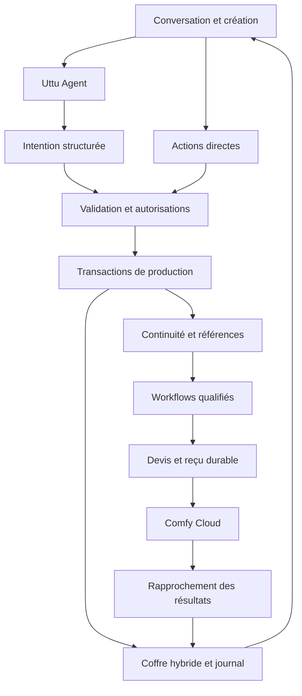

# Cinema Engine — décisions AAA et tranche P0

Spécification Astra du 1er novembre 2026, synchronisée sur `main` **77094dd29ab3f176ac53145c465c4699f8d886f8**. Documentation seulement. Aucun changement d'interface, merge ou test payant n'est autorisé par sa publication.

**Mise à jour de validation : U1 approuvé par JD le 1er novembre 2026.** [Accord](https://github.com/eNudimmud/U-TTU-Studio/pull/222#issuecomment-6557202544). CE4 peut être implémenté sur sa branche dédiée selon les dépendances ; la validation ne vaut pas accord de merge ou de dépense.

## Source commune et acquis

Le suivi reste dans [#216](https://github.com/eNudimmud/U-TTU-Studio/issues/216). Réutiliser les documents Cursor : [ETAT-TECHNIQUE et DEMO-P0, PR #215](https://github.com/eNudimmud/U-TTU-Studio/pull/215), [SOUMISSION, PR #219](https://github.com/eNudimmud/U-TTU-Studio/pull/219). Ils restent sur leurs branches tant que JD n'a pas approuvé leur merge. Ne pas créer un deuxième scénario, dossier de soumission ou tableau d'avancement concurrent.

Ce dossier ajoute [les contrats](CONTRACTS.md), [la stratégie workflows](CINEMA_WORKFLOWS.md), [les lots exécutables](../implementation/CINEMA_LOTS.md) et [le design U1](UX_REVIEW.md). Ce n'est pas une copie prétendument retrouvée du « Plan AAA » historique.

| Acquis vérifié sur GitHub | Conséquence |
| --- | --- |
| #209 et #211 fusionnées | Moteurs Klein/Qwen/FLUX.2, billing via relais, quatre onglets et retrait de l'ancien film à conserver |
| #217 fusionnée | `takePrompt` sépare les personnages ; `castReferences` privilégie les photos et équilibre les vues. Ne pas réimplémenter T1/T2 |
| #218 fusionnée | Dix tests de non-régression P0 déjà présents. Les étendre pour les nouvelles frontières |
| #220 fusionnée | Mode open weights par défaut, Partner nodes masqués, Finaliser passe par SeedVR2. Réutiliser la politique existante |
| #221 fusionnée | Storyboard rendu serveur et chargement différé des thumbnails ; préserver ces gains |
| CI de `77094dd` | [Run 41276351607 réussi](https://github.com/eNudimmud/U-TTU-Studio/actions/runs/41276351607), statut vérifié directement |

Cursor rapporte 856/857 tests sur ce main, 0 échec et typecheck vert, dans #216. Astra n'a pas réexécuté cette suite. La première revue Astra avait passé 42 tests ciblés sur l'ancien main `0e4d6a5` : ce résultat historique ne valide pas les nouveaux commits. Les mesures Lighthouse de #221 sont des médianes de laboratoire sur trois runs, pas des données terrain : `/storyboard` 4,95 → 2,87 s, `/studio` 6,21 → 4,27 s. Ne pas relancer un audit complet.

L'état technique de #215 restitue l'audit et les 859 tests ; les mesures récentes sont dans #221. Le document source exact du Plan AAA et la revue exhaustive du 31 octobre ne sont pas attachés dans les fichiers examinés : Cursor peut les lier dans #216, sans bloquer les lots ni passer par JD.

## Les trois écarts qui restent

1. **Agent → opérations** : #214 reste ouvert. L'agent Comfy appelle GPT-5 Nano et ne produit pas de transactions storyboard. Choix : agent natif Qwen3-VL 8B à qualifier, sorties typées, validation déterministe ; aucun second agent visible.
2. **Références jusqu'au graphe** : `storyboard/film.ts::versPlanFilm` transmet les `qui/ou`, pas les images objet/style. `ltx-graph.ts` conserve un préambule mono-personnage et tronque à quatre images ; #217 n'a pas corrigé ces lignes. Corriger les rôles/capacités, pas seulement les mots du prompt. Le filtre pixel des planches n'est pas raccordé au chemin film ; le sélectionner dans une préparation asynchrone partagée, sans changer la fonction pure en cachette.
3. **Reprise de la séquence** : les reçus Comfy existent ; la file et le retour storyboard dépendent encore de l'état de la page. Étendre le settlement durable jusqu'au registre et aux projections, avec un test de fermeture/rechargement. C'est un risque de reprise à éprouver, pas une perte de données réelle affirmée sans preuve.

## Architecture cible

| Module | Responsabilité | Adaptation de l'existant |
| --- | --- | --- |
| Intent Engine | Objectif, opération, portée, contraintes, références, verrous, résultat et permissions | Nouveaux validateurs dans `lib/cinema`, pas un simple prompt enrichi |
| Uttu Agent | Un réalisateur conversationnel, contexte du projet, explication courte sur demande | Adapter l'agent existant ; pas de noyau vendored modifié à la main |
| Prompt Intelligence | Traduire la photographie, composition, lumière, mouvement, texture et genre pour le modèle exact | Compilateurs spécifiques autour des builders existants |
| Living Storyboard | Plans, variantes, durée, réordre, historique et animatique | Conserver `PlanSB`, le JSON et la projection Markdown |
| Continuity Engine | Identité, apparence, costume, pose, lieu, objet, style et caméra séparés | Bindings par ID/hash, snapshots par plan, contraintes de raccord |
| Invisible Workflow Engine | Routage par capacités, admissibilité et preuves | Étendre le registre et `open-weights.ts`, sans second catalogue divergent |
| Cloud Production | Jobs, assets, coûts, reprise et associations | Réutiliser le client, reçus, coffre, upload memo et médiathèque |
| Production Workspace | Conversation, canvas, contexte à la demande | Évolution du storyboard selon U1 validé, quatre domaines métier préservés |
| Postproduction | Prises gardées, timeline, finition dérivée, son et exports | Export existant annoncé honnêtement ; extension progressive |

### ADR-01 — Monolithe modulaire, contrats stables

Créer `src/lib/cinema/` pour services purs et adapters. Les commandes directes et conversationnelles passent par les mêmes invariants. Un unique intégrateur raccorde `studio-session.tsx`, point partagé des rendus ; aucun découpage massif de l'application avant mardi. Le storyboard exprime l'intention ; le registre conserve prises et montage ; le journal relie opérations et résultats. Les vues et compteurs sont reconstructibles.

### ADR-02 — Agent natif, sans droit de payer

Décision publiée dans [#214](https://github.com/eNudimmud/U-TTU-Studio/issues/214#issuecomment-6556991690) : candidat principal **Qwen3-VL 8B conversationnel** via `llm_qwen3vl_text_gen`, `TextGenerate`, sortie `PreviewAny`. La disponibilité du catalogue rapportée par Cursor n'est pas un run réussi. Épingler le fichier exact, sa provenance et son profil avant qualification. Qwen3.5 reste un comparatif possible si nécessaire, sans bascule automatique ni fournisseur supplémentaire.

L'agent propose des opérations ; le programme valide IDs, révisions, verrous et autorisations. Une commande locale peut fonctionner sans modèle, mais n'est pas présentée comme une réponse IA. JSON invalide : diagnostic sans mutation ni réparation payante automatique. Aucun appel GPT-5 Nano dans le parcours concours. Les appels texte sont des jobs asynchrones et des dépenses comme les autres.

### ADR-03 — Continuité typée et première image validée

Conserver la **méthode A** déjà engagée par #217 : vues propres équilibrées, description issue de la fiche, bindings séparés. Ne pas activer la méthode B multi-passes ni ajouter son sélecteur avant benchmark et accord budget/UI. Une édition successive n'est pas « sans mélange possible » : elle peut aussi altérer un personnage déjà présent.

Pour le P0 vidéo : composer l'image clé avec les refs, la faire valider, puis animer cette image seule avec LTX-2.5. Le moteur garantit le bon routage et la traçabilité ; la qualité visuelle et les identités restent à valider sur les résultats. Toute correction touche un plan/une variante, jamais toute la séquence automatiquement.

Le scénario de #215 reste le brouillon de référence. Recommandation artistique à soumettre : remplacer le saut sur l'épaule du plan 3 par une action plus simple pour le premier test. Ne pas le changer sans JD. Aucun nouvel aspect des personnages n'est inventé ; les descriptions de #215 proviennent de son inventaire, pas d'une inspection des fichiers privés par Astra. Les droits restent à confirmer.

### ADR-04 — Identifiants et versions immuables

Les noms `@Nom` sélectionnent des références ; ils ne sont jamais la clé d'identité. Épingler projet, catégorie, entity ID et hashes. Un job garde la révision de départ ; son résultat tardif devient une prise de cette révision et ne remplace pas celle gardée. Préserver les `planFilmId` historiques. Les nouveaux mappings utilisent des IDs opaques persistants, pas des concaténations tronquées.

Une suppression éditoriale archive. Undo crée une opération inverse ; les médias originaux et versions validées restent accessibles. Un décor ne fournit pas les traits du personnage ; un guide de cadrage ne fournit ni costume ni style.

### ADR-05 — Cloud et reprise conservatrice

Comfy Cloud reste le stockage distant des générations selon ses capacités réelles ; le coffre maintient cache, métadonnées et associations de production. Ne pas promettre une durée de conservation ou une récupération par listing non vérifiée. Un résultat Cloud indisponible est signalé ; aucune reconstruction automatique par génération.

Étendre `PendingRender`/`InFlight`, ne pas créer un second système de soumission. Persister avant POST. Réponse perdue : `submission_unknown`, lectures de statut seulement, rapprochement explicite si nécessaire. Jamais cancel automatique ni retry silencieux. L'arrivée du résultat est traitée hors du composant storyboard : asset durable, prise idempotente, associations, projections.

P0 mono-utilisateur : verrous navigateur par compte/projet, une soumission active. Ils ne sont pas distribués entre appareils. P1 : index médias et synchronisation incrémentale avec les permissions existantes. P2 : collaboration et contrôle de concurrence serveur si introduits explicitement.

### ADR-06 — Politique concours et budget

Réutiliser #220 pour filtrer le catalogue ; ajouter une validation du graphe effectif à la frontière de soumission, incluant modèles texte/upsamplers et chemins directs. « Comfy » n'est pas une preuve d'open weights. H3 natif et H3 Max Partner ne sont pas le même modèle ; le P0 retenu ici utilise LTX/Klein et ne remet pas H3 Max en avant.

Le solde amélioré par #209 reste une télémétrie. L'autorisation vient de JD, liée à tranche, opération, devis et snapshot. Compter aussi texte, tentatives et sommes incertaines dans le plafond de 300. Devis absent ≠ zéro ; afficher « ≈ X crédits estimés » seulement avec une base applicable. Une réserve locale ne garantit pas la facture fournisseur : arrêter les nouvelles soumissions si le restant devient inconnu/insuffisant.

### ADR-07 — Finaliser et exporter

Finaliser exige une prise source et crée une prise dérivée. Il ne passe jamais par une génération créative de scène. #220 impose déjà SeedVR2 dans ce mode ; garder l'original et comparer les détails, car une restauration générative peut les altérer. Pas de promesse d'identité pixel parfaite.

P0 : épreuve MP4 actuelle **960×540, 12 fps, maximum 60 s**, plus originaux. L'affichage de cette limite relève du lot UX validé. Ne pas promettre un master 1080p/4K simplement parce que le modèle peut produire une haute résolution. Haute résolution, sous-titres et audio avancé restent P1/P2.

## Intelligence cinématographique interne

Les compétences narration, scénario, découpage, art, photographie, animation, continuité, diagnostic et montage alimentent le même agent. Elles ne créent ni agents autonomes dépensiers ni panneaux de paramètres. Le contexte comprend la sélection, les IDs autorisés, les verrous, les révisions, les capacités qualifiées et un résumé narratif.

Le compiler sépare identité, apparence, costume, pose, décor, style et cadrage ; il traduit focales, profondeur de champ, mouvement, lumière et texture selon les capacités du modèle. Une focale décrite dans un prompt n'est pas une caméra physique garantie. Aucun photoréalisme imposé à une animation verrouillée. Les genres servent de grammaire visuelle, pas de stéréotypes qui remplacent la demande. Les notes utilisateur sont des données, pas des instructions permettant de contourner la politique.

## Sécurité et observabilité

Pas de secret dans graphes, fixtures, logs, captures, prompts ou journaux. La clé est détenue par le navigateur et transmise au dernier instant par le transport existant ; le relais same-origin actuel la traite transitoirement. Ne pas prétendre qu'elle ne traverse jamais de serveur, ni ajouter un stockage serveur. Aucune connexion Vercel/Google depuis l'agent.

Journaliser operation ID, projet, plan, révision, graph digest, job ID, états et coût/provenance, sans prompt privé complet ou URL signée. Dédupliquer uploads par compte + hash, jamais entre comptes. Une référence manquante bloque le plan concerné, pas le projet entier ; elle n'autorise pas une nouvelle identité.

## Roadmap et conditions de sortie

| Horizon | Capacités | Preuve de passage |
| --- | --- | --- |
| P0 avant mardi | Agent → trois plans → workflow natif → résultat correctement associé → export | Lots CE0–CE5, refs/droits/compositions approuvés, répétition réelle dans DEMO-P0 |
| P1 | Historique complet, variantes comparées, montage conversationnel, contrôles spatiaux, bibliothèque qualifiée | Migrations restaurables, pas d'orphelins, benchmark par tâche |
| P2 | Son, coupes au rythme, guides narratifs, compositing, sous-titres, export master | Alignement temporel, fidélité et compatibilité mesurés |
| AAA durable | Continuité inter-séquences, permissions de production, collaboration et coût prévisible | Assets/versioning, évaluation de qualité, audit des opérations et droits |

Gel mardi 3 novembre 10:00 Zurich ; dossier prêt 16:00 ; échéance officielle 18:00 (09:00 PT). La candidature initiale a déjà été déclarée soumise par JD le 30 octobre : **préparer une mise à jour de cette candidature, pas une seconde soumission**. Vérifier le mécanisme d'édition avant toute publication. Garder le clip et la capture existants intacts ; une nouvelle version éventuelle est distincte.

Statuts à maintenir dans #216 : réalisé et testé / réalisé non testé / partiel / bloqué / planifié. Le P0 de bout en bout n'est pas validé par la seule CI. Aucune réception ou exécution des lots par Cursor n'est présumée sans son retour GitHub.
