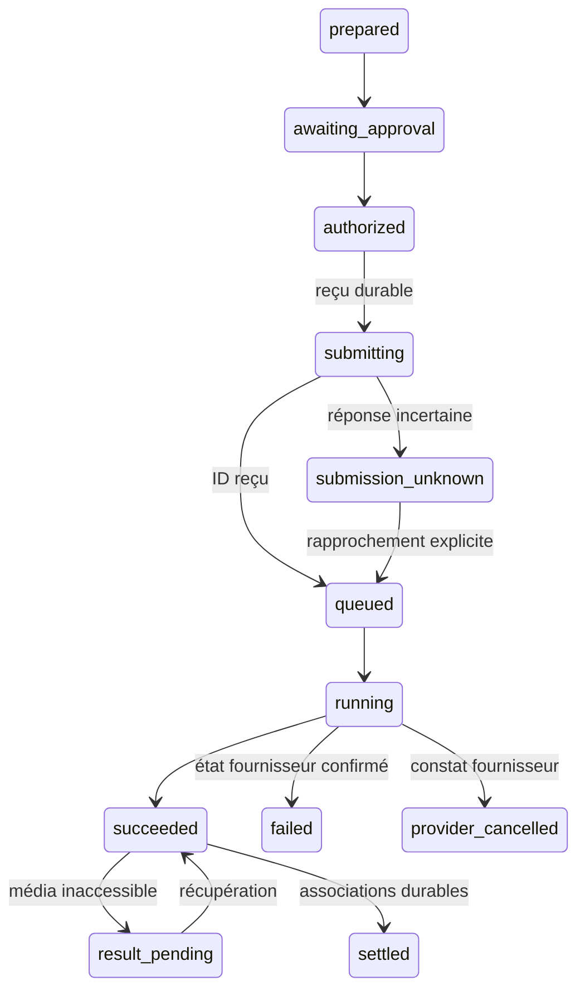

# Contrats Cinema Engine v1

Spécification à implémenter par adapters. Les types historiques français restent compatibles ; TypeScript ne dispense jamais de validateurs runtime pour réponses modèle, coffre ou import. [Décisions](CINEMA_ENGINE.md), [lots](../implementation/CINEMA_LOTS.md).

## Intention → transaction

```ts
type Scope = { projectId: string; storyboardId: string };
type Target = Scope & { shotId: string; expectedRevision: number };
type Operation =
  | { kind: 'storyboard.create'; scope: Scope; shots: ShotDraft[] }
  | { kind: 'shot.patch'; target: Target; patch: EditableShotPatch }
  | { kind: 'shot.duplicate'; target: Target }
  | { kind: 'shot.archive'; target: Target }
  | { kind: 'storyboard.reorder'; scope: Scope; expectedRevision: number; shotIds: string[] }
  | { kind: 'shot.prepare'; target: Target; output: 'keyframe' | 'video' }
  | { kind: 'take.finish.prepare'; target: Target; sourceTakeId: string; recipeId: string }
  | { kind: 'sequence.export.prepare'; scope: Scope; takeIds: string[] };
interface IntentEnvelope {
  schemaVersion: 1;
  operationId: string;
  source: 'conversation' | 'direct';
  userText: string;
  creativeGoal: string;
  expectedResult: string;
  operations: Operation[];
  rationale: string;
  unresolved: { field: string; reason: string; candidateIds: string[] }[];
}
```

Le client attribue UUID, scope, auteur, révisions et IDs des nouveaux plans. La réponse modèle n'est qu'un DTO de proposition. `ShotDraft` reprend les champs éditables de `PlanSB` : titre, action, refs, cadrage, camera, duree (5/8/10), format, rendu, dialogue, son, raccord, promptManuel. `EditableShotPatch` n'accepte que ces champs ; pas de paths arbitraires, IDs, prises, budget ou accord dans un patch. Les changements de verrous demandent une intention explicite vérifiée.

`parseIntent(raw, context)` retourne `valid | needs_clarification | invalid`. Extraire au plus un objet JSON borné ; accepter une enveloppe Markdown, pas des objets concurrents ni du code. Valider chaque champ, ID du catalogue autorisé, taille, révision et opération. « Ce plan » exige une sélection ; un nom ambigu exige résolution, pas création implicite. Reorder exige une permutation exacte des plans actifs. La création de trois plans est une transaction indivisible.

Le modèle ne produit pas `SpendApproval` et ne déclenche pas de réseau. Les commandes `prepare` préparent seulement. Appliquer une édition demandée explicitement peut être réversible et immédiat ; générer attend l'accord utilisateur. JSON invalide => aucune mutation et aucune deuxième requête payante automatique. Undo écrit une opération inverse ; un historique ancien ne peut autoriser une nouvelle dépense.

## Références et snapshot

```ts
type ReferenceRole = 'identity' | 'appearance' | 'costume' | 'pose'
  | 'environment' | 'object' | 'style' | 'framing';
interface ReferenceBinding {
  bindingId: string;
  projectId: string;
  entityId: string;
  referenceId: string;
  category: 'cast' | 'decor' | 'objet' | 'style';
  role: ReferenceRole;
  images: { assetId: string; sha256: string }[];
  required: boolean;
  locked: boolean;
}
interface ShotSnapshot {
  schemaVersion: 1;
  scope: Scope;
  shotId: string;
  revision: number;
  planFilmId: string;
  creative: ShotDraft;
  bindings: ReferenceBinding[];
  sourceTakeId?: string;
  approvedKeyframeAssetId?: string;
  digest: string;
}
interface CompiledReferences {
  orderedAssetIds: string[];
  slots: { bindingId: string; role: ReferenceRole; imageIndices: number[] }[];
  diagnostics: { code: string; bindingId?: string }[];
}
```

Mapping historique : `qui → identity`, `ou → environment`, `objet → object`, `style → style`. Résoudre par projet/catégorie/ID, jamais par nom global. Pour les anciennes cartes, la clé composite est stable ; rapprocher plusieurs cartes d'une même identité uniquement par lien explicite. Renommer ne change pas l'identité ; changer les pixels change le hash et invalide la préparation.

Chaque référence nommée contient au plus trois images. Le nombre de références distinctes reste extensible dans les limites réelles ; la génération garde ses limites spécifiques (sept sur les chemins de création actuels ; quatre images dans le builder LTX existant). Un manifeste indique `maxBindings` et `maxImages` séparément. Refuser une troncature des références requises ; ne jamais perdre le décor parce qu'il est cinquième après quatre vues CAST.

`castReferences` de #217 reste une sélection pure. Ajouter en amont une préparation asynchrone des photos réellement décodées : classification planche/vue propre, cache par hash, résultat explicite partagé entre devis et soumission. Une erreur de lecture ne signifie pas « photo propre ». Le filtre pixel ne doit pas supprimer toutes les vues silencieusement. Les slots, noms et descriptions doivent rester alignés après filtrage/équilibrage.

L'ordre physique des images n'impose pas leur rôle. Deux personnages ne deviennent pas une identité parce qu'ils sont adjacents. Décor, costume, style et cadrage ne fournissent pas les traits du sujet. Ne pas propager les refs du plan précédent sans contrainte de continuité explicite. Une référence inconnue bloque ce plan et n'autorise pas `nouveaux` à inventer Enki ou Fizz.

Uttu : les sept références officielles doivent être disponibles avant toute génération. Une collection peut relier plusieurs cartes de trois images à une même identité ; elle ne dispense pas de vérifier que le workflow consomme les références requises. Aucun test Uttu prévu sans cette collection. Pas d'identité « Mira ».

Le digest utilise SHA-256 des assets et une sérialisation canonique à clés triées de tous les paramètres pertinents, dont seed, durée, résolution, prompt, verrous et modèle. Exclure clés, headers et URLs signées. Les entrées d'un job restent immuables après soumission.

## Workflow, devis, autorisation

```ts
interface WorkflowManifest {
  id: string; version: string; graphSha256: string; compilerVersion: string;
  purpose: 'intent' | 'keyframe' | 'animation' | 'finishing';
  provider: 'comfy-cloud';
  models: { file: string; source: string; license: string; digest?: string }[];
  nodeTypes: string[];
  capabilities: { roles: ReferenceRole[]; maxImages: number; maxBindings: number;
    formats: string[]; durations: number[]; outputKinds: string[] };
  qualification: 'candidate' | 'validated' | 'demo' | 'retired';
  evidence: { commit: string; checkedAt: string; runIds: string[] };
}
interface Quote {
  id: string; snapshotDigest: string; workflowDigest: string;
  estimatedCredits: number | null;
  uncertaintyCredits: number | null;
  basis: 'provider' | 'measured_similar_job' | 'unavailable';
  createdAt: string; expiresAt: string;
}
interface SpendApproval {
  id: string; trancheId: string; operationId: string;
  quoteId: string; snapshotDigest: string; workflowDigest: string;
  authorizedCeilingCredits: number;
  actor: 'user'; approvedAt: string;
  consumedByAttemptId: string | null;
}
```

L'admissibilité est une vérification séparée, sourcée, de tous les poids et nœuds du graphe effectif. Étendre la politique #220, ne pas en créer une concurrente. Un manifeste inconnu/candidat ne peut être sélectionné pour une démo déclarée qualifiée. Aucun fallback de modèle après erreur.

Un accord est consommé une fois. Changement d'entrée, modèle, prix hors accord ou expiration => nouveau devis/accord. Reprendre le polling n'est pas une nouvelle tentative. Échec fournisseur confirmé : une nouvelle tentative exige décision utilisateur. Les soumissions et coûts incertains restent réservés. Le ledger tient dépenses + réservations de toutes les modalités ; ne pas initialiser « 300 disponibles » sans connaître les tests déjà engagés.

Coût observé séparé du devis : provenance `billing_job | gpu_estimate | unknown`. Une différence de solde n'est pas une facture certaine. Les unités de billing doivent être validées par schéma/fixture fournisseur ; ne pas assimiler automatiquement cents et micros. Un refus de crédits du fournisseur n'est jamais une autorisation.

## Job et reprise

```ts
type JobState = 'prepared' | 'awaiting_approval' | 'authorized' | 'submitting'
  | 'submission_unknown' | 'queued' | 'running' | 'succeeded'
  | 'failed' | 'provider_cancelled' | 'result_pending' | 'settled';
interface JobReceipt {
  schemaVersion: 2;
  operationId: string; attemptId: string; accountScope: string;
  snapshot: ShotSnapshot | IntentJobSnapshot;
  quote: Quote; approval: SpendApproval;
  state: JobState; providerJobId: string | null;
  submittedAt: string | null; updatedAt: string;
  outputs: { assetId: string; kind: string; sha256?: string }[];
  settlement: 'none' | 'assets_saved' | 'take_saved' | 'projections_saved';
  error?: { code: string; safeMessage: string };
}
```

`IntentJobSnapshot` contient portée, demande, révisions et digest du contexte ; pas une fausse prise. `accountScope` est un identifiant opaque du compte, jamais la clé ni un hash de la clé. La proposition texte est stockée et validée ; elle n'est pas ajoutée au montage comme média.



Accepter un saut direct vers un état terminal confirmé sans avoir observé `running`. Ne pas régresser un terminal sur un polling ancien. `provider_cancelled` est un constat, jamais une instruction du Studio. Timeout, changement d'onglet ou navigation ne sont pas un échec fournisseur.

Réutiliser les reçus `u-ttu-operation`/`u-ttu-rendu`, `bindPendingJob`, `projectVault`, le client et les verrous existants. Migration additive, une seule autorité de soumission. Persistance indisponible avant POST => ne rien soumettre. Une operation ID locale ne prouve pas l'idempotence du Cloud ; aucun retry POST après réponse perdue. Polling/lecture retryable avec backoff borné, reprise à la reconnexion, jamais annulation.

## Settlement, histoire et migration

`settle(receipt, outputs, store)` déduplique par `(accountScope, providerJobId, outputIndex)`. Vérifier projet, plan, révision, média et accès. Ordre : asset durable → prise du registre → projection storyboard → marqueur settled. Chaque étape est rejouable sans duplication. Une fermeture entre deux étapes ne perd pas la prise.

Une prise ajoutée ne remplace pas la prise gardée. Résultat d'une ancienne révision : variante de cette révision. Plan archivé : conserver résultat dans son historique sans réactiver le plan. Projet inaccessible : `result_pending`, jamais rattachement au projet ouvert. Étendre les adapters de `settleLandedTake` vers le registre sans dépendre de `/storyboard` monté.

`TakeRecord` ajoute operation ID, révision, workflow digest, asset IDs, sourceTakeId éventuel et preuve de coût aux prises historiques. Le montage référence take ID, in/out et timebase ; pas de copie destructive du média. `finish` exige sourceTakeId et manifeste finishing, produit une dérivée et laisse l'original intact.

Conserver `.uttu/sb-<id>.json`, `.uttu/registre-plans.json` et `Storyboard/<id>.md`. Métadonnées additionnelles P0 dans `.uttu/cinema-<boardId>.json`, journal `.uttu/op-<uuid>.json`, chemins validés par l'API coffre. Avant migration, sauvegarder et vérifier les métadonnées ; préserver IDs et champs inconnus, refuser un schéma futur. Pas de nouvel index obligatoire pour ouvrir un projet ancien.

Sous verrou de projet : lire révisions → journal préparé avec hashes avant/après → écrire projections → journal appliqué. Après crash, si chaque cible correspond à son hash avant/après, terminer ; sinon conserver les deux versions et signaler conflit. Une écriture inconnue ne doit jamais être écrasée par une « réparation ». Undo est une transaction inverse. Rollback restaure métadonnées sans supprimer médias ni jobs.

## Erreurs stables et ports

Services : `parseIntent`, `applyOperation`, `compileReferences`, `prepareJob`, `submitApproved`, `reconcile` (lectures seules), `settle`. Ils sont testables sans React ni Cloud ; les adapters portent le réseau et le coffre.

Codes : `REFERENCE_MISSING`, `REFERENCE_AMBIGUOUS`, `REFERENCE_CAPACITY`, `REVISION_CONFLICT`, `LOCK_CONFLICT`, `WORKFLOW_UNQUALIFIED`, `MODEL_INELIGIBLE`, `QUOTE_UNAVAILABLE`, `APPROVAL_REQUIRED`, `BUDGET_RESERVED`, `SUBMISSION_UNKNOWN`, `PROJECT_UNAVAILABLE`, `OUTPUT_INVALID`, `STORAGE_UNAVAILABLE`. Messages EN/FR/DE/ES, sans secret ni stack trace. Aucun code n'implique annulation ou régénération automatique.
