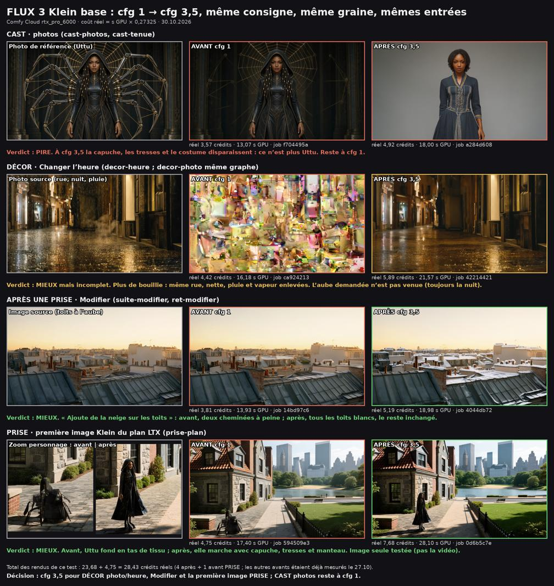

# FLUX 3 Klein base : cfg 1 → 3,5 sur les outils d’édition (30.10.2026)

Le modèle base `flux3-image-klein-base-int8-convrot` attend un guidage de 3,5. Le template d’édition officiel garde cfg 1 (reste du modèle distillé). La bulle est passée à 3,5 en #177 ; ici, les autres chemins d’édition Klein base.

Méthode : même graphe, même consigne, même graine, mêmes entrées ; seul `cfg` change. Comfy Cloud, rtx_pro_6000, coût réel = secondes GPU × 0,27325.

| Outil | Avant (cfg 1) | Après (cfg 3,5) | Verdict | Devis |
|---|---|---|---|---|
| CAST photos (`cast-photos`, `cast-tenue`) | f704495a · 3,57 | a284d608 · 18,00 s · 4,92 | Pire : capuche, tresses et costume perdus, ce n’est plus Uttu | reste à cfg 1, devis 4 / 6 inchangé |
| Changer l’heure (`decor-heure`) | ca924213 · 16,18 s · 4,42 (bouillie ; fa472751 aussi) | 42214421 · 21,57 s · 5,89 | Mieux mais incomplet : rue nette, mais l’aube demandée n’est pas venue | 4 / 7 → 6 / 9 |
| Décor depuis une photo (`decor-photo`) | même graphe que l’heure | — | suit `decor-heure` | 4 / 6 → 6 / 9 |
| Modifier (`suite-modifier`) | 14bd97c6 · 13,93 s · 3,81 | 4044db72 · 18,98 s · 5,19 | Mieux : neige sur tous les toits, le reste inchangé | 4 / 6 → 5 / 8 |
| Première image de la prise LTX (`prise-plan`) | 594509e3 · 17,40 s · 4,75 | 0d6b5c7e · 28,10 s · 7,68 | Mieux : Uttu entière au lieu d’un tas de tissu | 15 / 23 → 18 / 27 (15,10 + 2,93) |

Le Klein 9B distillé (`suite-elargir`, élargir le décor) reste à cfg 1.

Total des rendus de ce relevé : 28,43 crédits réels.

