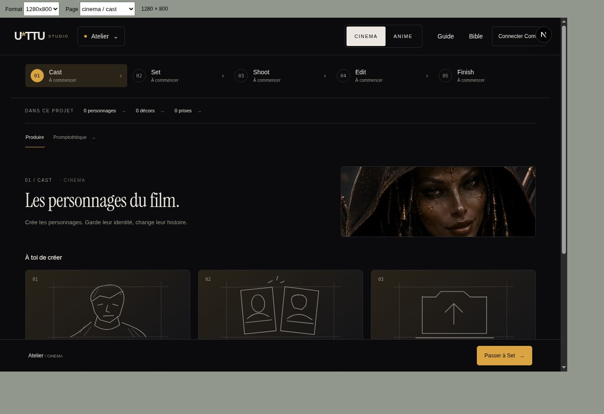
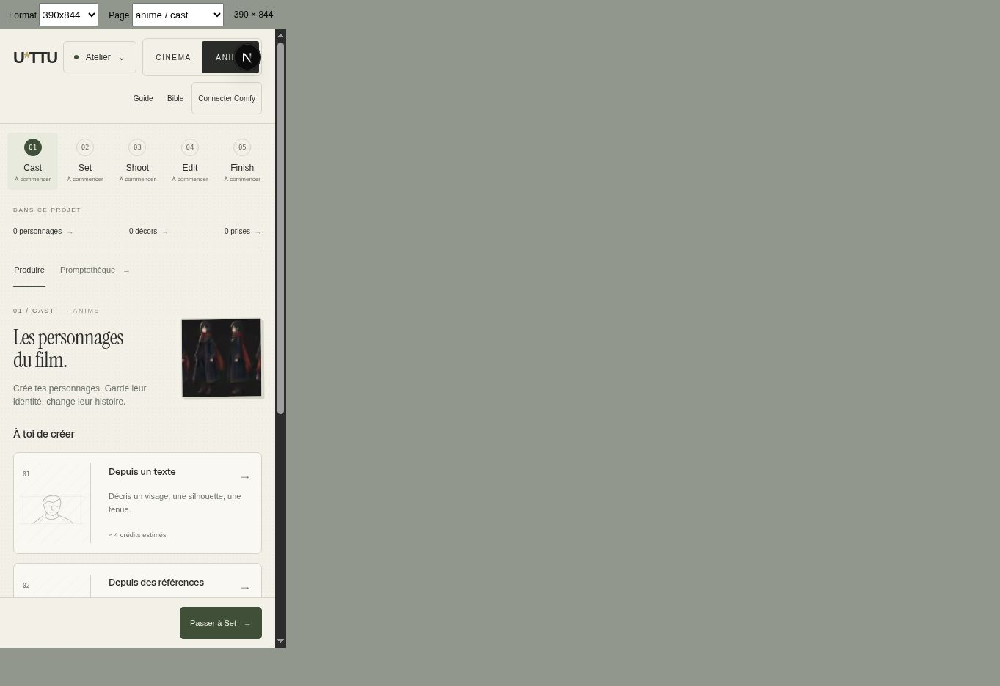

# Validation des sections CINEMA et ANIME — 5 novembre 2026

Les PR #254–#260 restent empilées et en brouillon. Aucun rendu payant, aucune fusion dans main. Les corrections d’Uttu (`621df16`, `557204d`, `2d4e49d`) sont conservées.

## Vérifications effectuées sur l’intégration

- `npm run typecheck` : succès.
- `npm test` : 1 197 tests, 1 196 réussis, 1 ignoré, 0 échec.
- `npm run build` : succès (Next 16.3.8, webpack).
- Navigateur Chrome : 48 vues mesurées, soit Cast, Set, Shoot, Edit, Finish et Promptothèque dans les deux univers à 390×844, 844×390, 1024×600 et 1280×800. Pas de débordement horizontal ; tous les liens, boutons, champs et sélecteurs visibles mesurés atteignent 44 px. La mesure porte sur les pages au repos, sans prétendre couvrir toutes les modales. Voir [mesures](sections-qa/responsive.json).
- Parcours local ANIME observé : import d’une image réelle du dépôt → prise 01 → garder → ajouter au montage → nommer → enregistrer → recharger → exporter → résultat conservé. Vidéo exportée : 1920×1080, durée 4,032 s. Le résultat reste disponible après rechargement.
- Une image uniforme est refusée à l’import. Le nouveau test de coût différé prouve qu’aucune lecture de facturation ni attribution n’a lieu avant l’appel post-sauvegarde, et que deux appels ne mesurent qu’une fois.

## Corrections livrées

- Le média doit être conservé et relu avant d’enregistrer son coût. Les résultats invalides, incomplets ou provenant d’un autre nœud ne sont pas enregistrés comme succès.
- Reprise persistante sans second POST automatique ; une prise gardée reste exclusive par plan et par univers.
- La finition ne propose que l’amélioration de la prise gardée, sans variante ni animation dans Finish. L’original reste disponible.
- Le montage est revalidé avant son export puis avant la conservation de l’export. Les états de chargement, les blocages et la limite de 60 secondes sont expliqués.
- Les anciennes routes `/anime`, `/look`, leurs bibles, `/studio/cgi` et `/guide/cgi` conservent leurs paramètres lors de la redirection.
- CINEMA reprend le graphite et le doré de la maquette. ANIME conserve le papier clair. Les outils avancés réutilisent le catalogue qualifié, sans nœuds partenaires.

## Limites et critères restant ouverts

- `e2e/sections-production.spec.ts` couvre les deux parcours d’export, les 48 vues et les redirections. Son exécution Playwright locale a été empêchée par le lancement du navigateur (sandbox/socket EPERM). Les observations ci-dessus ont été faites dans le navigateur de prévisualisation ; elles ne constituent pas un résultat de cette suite automatisée.
- Les anciennes suites E2E ciblent encore `/studio` et ses anciens hash alors que cette route mène désormais aux nouvelles sections. Leur migration doit préserver les assertions des parcours historiques sur `/studio/legacy` et tester séparément les redirections. Ne pas déclarer la CI globale verte sans son résultat.
- Les anciens liens de médiathèque et les actions de l’agent qui transportent un projet, une prise ou un média doivent être qualifiés avant fusion : ne pas perdre leur contexte dans la redirection vers les nouvelles sections.
- Les essais Cloud Qwen, WAI/IP-Adapter/ControlNet, vidéo et finition restent à lancer explicitement par JD. Les tests de graphe et de validation locale ne prouvent pas l’identité ni la qualité du rendu GPU. La cause exacte de l’ancien rendu blanc n’est pas déclarée résolue par un nouveau rendu réel.
- Le garde local empêche l’attribution d’un résultat invalide au projet ; il ne peut pas annuler une facturation effectuée par Comfy pour un calcul déjà exécuté.
- Le budget de performance et le parcours en quatre langues restent à qualifier sur une version de production. Aucun chiffre de latence Cloud ni score mobile n’est revendiqué ici.

La fusion reste réservée à JD après revue de la preview et des points ouverts ci-dessus.
